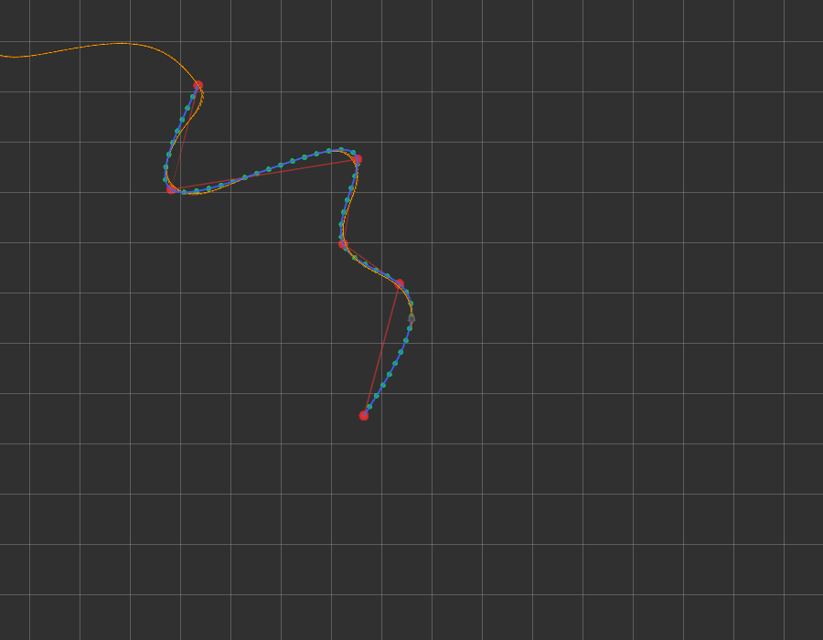
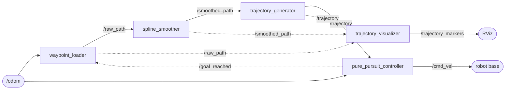
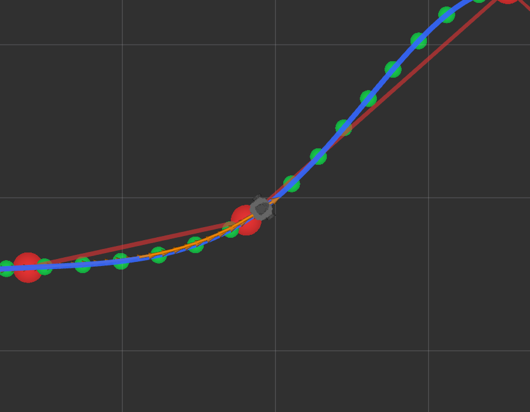
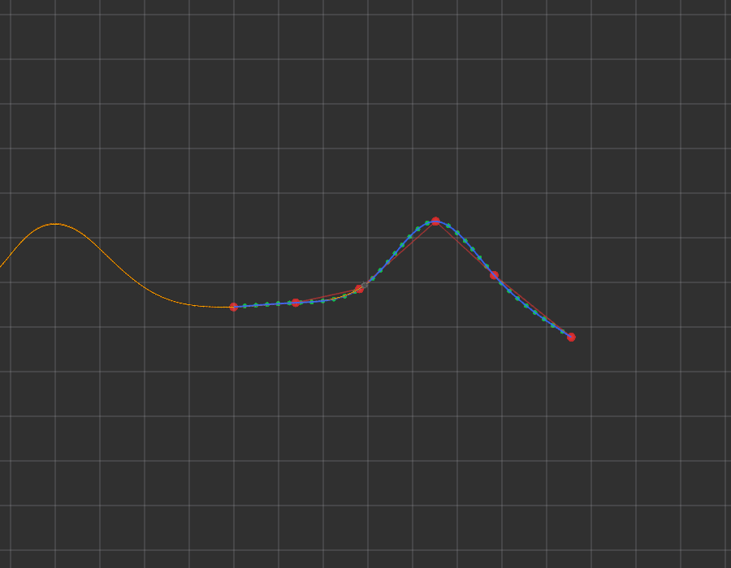
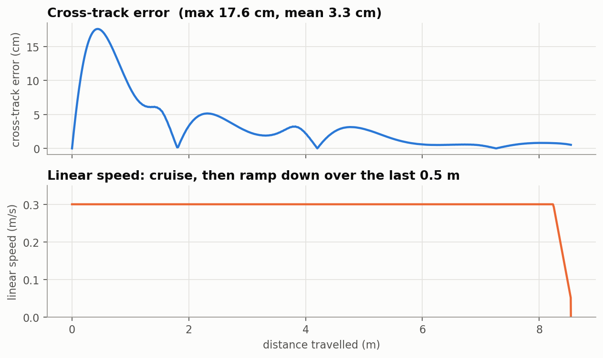

# trajectory_nav

A ROS 2 Jazzy package that turns a handful of waypoints into a smooth, timed trajectory and drives a differential-drive robot along it with pure pursuit.



*The demo after about two minutes. Red: raw waypoints. Blue: smoothed path. Green: trajectory samples. Orange: where the robot actually drove. Each new set of waypoints starts where the robot finished the last one.*

## What it does



1. **`waypoint_loader`** makes six random waypoints ahead of the robot, starting at its current pose. When the controller reports that the robot reached the last one, it makes a new set.
2. **`spline_smoother`** fits a natural cubic spline through the waypoints, using arc length as the parameter, and samples it every 5 cm.
3. **`trajectory_generator`** resamples that curve at exactly `sampling_distance` steps and stamps each pose with the time the robot should get there at constant speed.
4. **`pure_pursuit_controller`** steers towards a point 0.5 m ahead on the trajectory and publishes velocity commands. It slows down for the goal and stops within 0.2 m of it.
5. **`trajectory_visualizer`** draws every stage as RViz markers.

The paths are published once, when they change, on latched topics, so a node that starts late still gets the latest path.

## Quick start

You need ROS 2 Jazzy on Ubuntu 24.04.

```bash
# in a colcon workspace
cd ~/ros2_ws/src
git clone git@github.com:pavanmp140102/trajectory_nav.git
cd ~/ros2_ws
rosdep install --from-paths src --ignore-src -y
# on a robot with no display, skip the demo-only packages:
#   rosdep install --from-paths src --ignore-src -y \
#     --skip-keys "rviz2 turtlebot3_fake_node turtlebot3_description xacro robot_state_publisher"
colcon build --symlink-install
source install/setup.bash
```

**Run the demo.** No simulator is needed: TurtleBot3's kinematic fake node stands in for the robot, and RViz opens with the view above.

```bash
ros2 launch trajectory_nav demo.launch.py
```

**Run in Gazebo** with a simulated TurtleBot3 (two terminals):

```bash
# terminal 1
export TURTLEBOT3_MODEL=burger
ros2 launch turtlebot3_gazebo empty_world.launch.py

# terminal 2
ros2 launch trajectory_nav trajectory_nav.launch.py use_sim_time:=true rviz:=true
```

See [docs/TURTLEBOT3_INTEGRATION.md](docs/TURTLEBOT3_INTEGRATION.md) for real robots and troubleshooting.

## Results

| | |
|---|---|
|  |  |
| *Close-up: the robot (grey) on the blue path, with its trail in orange.* | *The second path starts where the first one ended.* |

In a kinematic simulation of the example path, the robot stays within 6 cm of the path once it has lined up. The largest error is 17.6 cm, at the very start, because the robot faces +x while the path leaves at about −45°. The mean error is 3.3 cm. In the fake-node demo, each goal is reached 0.20 m from the final point, which is the goal tolerance.



## Topics

| Topic | Type | Direction | QoS |
|---|---|---|---|
| `/odom` | `nav_msgs/Odometry` | in | sensor data (best effort); also accepts reliable publishers |
| `/raw_path` | `nav_msgs/Path` | waypoint_loader → | reliable, transient local, depth 1 |
| `/smoothed_path` | `nav_msgs/Path` | spline_smoother → | reliable, transient local, depth 1 |
| `/trajectory` | `nav_msgs/Path` | trajectory_generator → | reliable, transient local, depth 1 |
| `/cmd_vel` | `geometry_msgs/TwistStamped` (or `Twist`) | → robot | default |
| `/goal_reached` | `std_msgs/Empty` | controller → waypoint_loader | reliable, volatile, depth 1 |
| `/trajectory_markers` | `visualization_msgs/MarkerArray` | → RViz | reliable, transient local, depth 1 |

Each pose on `/trajectory` has its own `header.stamp`: the time the robot is planned to reach it. Details are in [docs/ARCHITECTURE.md](docs/ARCHITECTURE.md).

## Configuration

All parameters live in one file, [`config/trajectory_nav.yaml`](src/trajectory_nav/config/trajectory_nav.yaml). The ones you will most likely change:

| Parameter | Default | Effect |
|---|---|---|
| `velocity` | 0.3 m/s | Cruise speed. Shared by the trajectory timing and the controller. |
| `lookahead_distance` | 0.5 m | Smaller tracks tighter but can oscillate; larger is smoother but cuts corners. |
| `sampling_distance` | 0.05 m | Spacing of trajectory points. |
| `seed` | -1 | Fix it (for example `3`) to get the same paths on every run. |

The controller's tuning can be changed while it runs:

```bash
ros2 param set /pure_pursuit_controller lookahead_distance 0.7
```

The full list is in [docs/PARAMETERS.md](docs/PARAMETERS.md).

## Documentation

| Document | Contents |
|---|---|
| [ARCHITECTURE.md](docs/ARCHITECTURE.md) | Nodes, topics, message contracts, frames and the goal hand-over |
| [ALGORITHMS.md](docs/ALGORITHMS.md) | Spline smoothing, resampling, timing and pure pursuit, with figures |
| [PARAMETERS.md](docs/PARAMETERS.md) | Every parameter and launch argument, and tuning advice |
| [TURTLEBOT3_INTEGRATION.md](docs/TURTLEBOT3_INTEGRATION.md) | Fake node, Gazebo and real robot |
| [TESTING.md](docs/TESTING.md) | The test suite and the manual end-to-end check |
| [CHANGELOG.rst](src/trajectory_nav/CHANGELOG.rst) | What changed in each release |

## Repository layout

```
trajectory_nav/                     repository root
├── README.md
├── docs/                           documentation and figures
└── src/trajectory_nav/             the ROS 2 package (ament_python)
    ├── trajectory_nav/
    │   ├── path_math.py            waypoints, smoothing, resampling, timing (no ROS)
    │   ├── pure_pursuit.py         the tracker (no ROS)
    │   ├── simulation.py           kinematic closed-loop simulator for tests and figures
    │   ├── ros_utils.py            Path conversion, latched QoS, node entry point
    │   └── <five node modules>
    ├── launch/                     trajectory_nav.launch.py, demo.launch.py
    ├── config/trajectory_nav.yaml
    ├── rviz/trajectory_nav.rviz
    └── test/                       unit, closed-loop and lint tests
```

## License

Apache-2.0. See [LICENSE](src/trajectory_nav/LICENSE).
