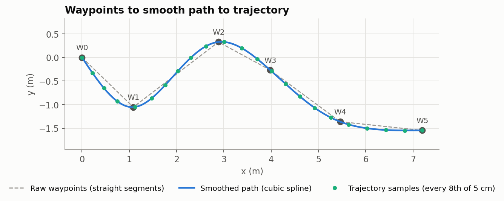
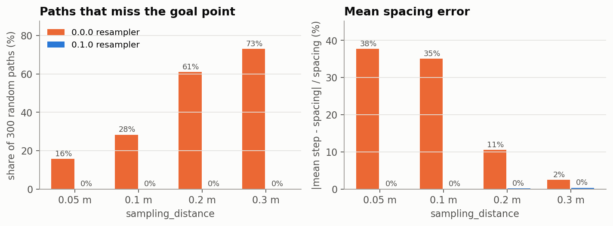
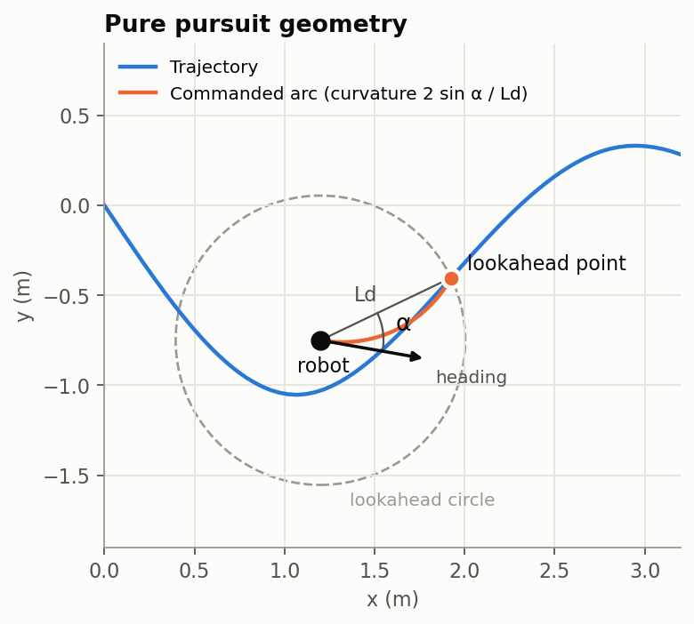
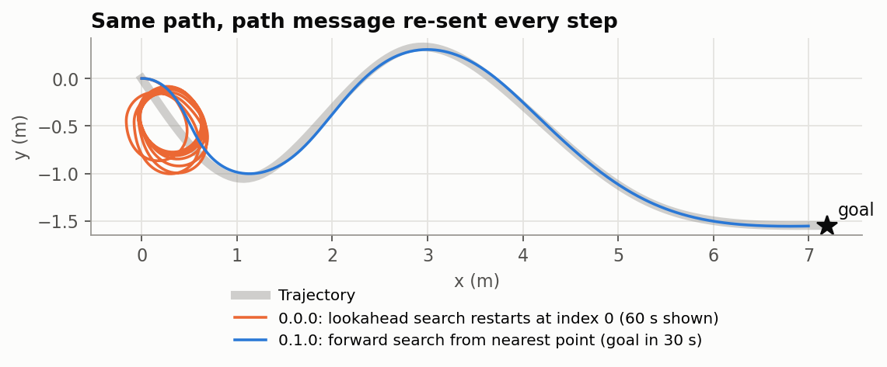
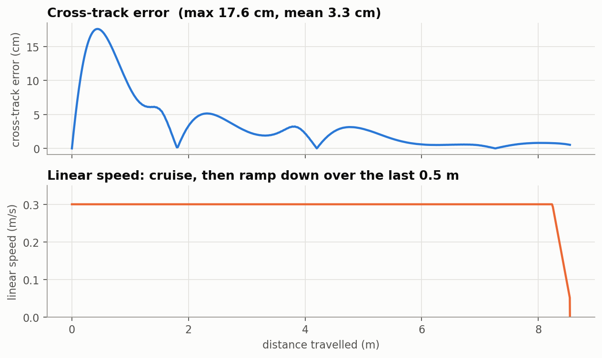

# Algorithms

This page covers the four steps between raw waypoints and velocity commands, and why each one works the way it does. Every figure on this page was generated by running the package's own code, in the kinematic simulator in `simulation.py` where a robot is involved.



## 1. Waypoints

`generate_waypoints(x, y, yaw, count, step_range, lateral_range)` places the first waypoint at the robot. Each later waypoint is a random 1–2 m further along the robot's heading, with a random sideways offset of up to ±2 m. Because the first waypoint is the robot itself, the controller never has to drive back to the `odom` origin when a new set arrives.

## 2. Spline smoothing

The raw waypoints form a polyline with sharp corners, which a differential-drive robot can't follow exactly. `smooth_path` replaces it with a curve:

1. **Remove duplicates.** Consecutive points less than 1 mm apart are dropped. A zero-length segment would make the spline parameter stop increasing, and SciPy would raise an error.
2. **Use arc length as the parameter.** With sᵢ as the distance along the polyline to waypoint i,

   s₀ = 0, sᵢ = sᵢ₋₁ + ‖pᵢ − pᵢ₋₁‖

   Fitting x(s) and y(s) separately against s means long and short segments get proportionate shares of the curve. Fitting against the index i instead distorts unevenly spaced waypoints.
3. **Fit natural cubic splines.** `scipy.interpolate.CubicSpline(s, x, bc_type='natural')`, and the same for y. The curve passes through every waypoint, has continuous curvature, and has zero curvature at both ends.
4. **Sample densely**, about every `resolution` metres (0.05 m by default), so the density doesn't depend on path length.

**Limitation:** a natural cubic spline can overshoot between closely spaced waypoints that turn sharply. Curvature is not limited. With the default waypoint spacing, the controller copes, as the multi-goal screenshot in the README shows. Waypoints from a planner with tight turns would need a curvature check or a different smoother.

## 3. Resampling and timing

`resample_path(x, y, spacing)` walks the smoothed path by cumulative arc length and interpolates a point at every multiple of `spacing`:

```python
s = cumulative_arc_length(x, y)
s_new = np.arange(0.0, s[-1], spacing)      # 0, d, 2d, ...
s_new = np.append(s_new, s[-1])             # always keep the end
x_new = np.interp(s_new, s, x)
```

Every step is exactly `spacing` along the path, except the last, which is shorter. The final point is always kept, so the trajectory ends at the goal.

The first release used a different method: it subdivided each segment and threw away samples closer than 0.9 × `sampling_distance` to the last kept one. That dropped the final point on 16–73 % of random paths and gave spacing up to 38 % off the requested value:



`assign_times` gives each point the time tᵢ = sᵢ / `velocity` (constant speed). The node adds the generation time t₀ and writes the result into each pose's `header.stamp`.

## 4. Pure pursuit



Pure pursuit picks a point on the path about one lookahead distance ahead and steers along the circular arc that passes through the robot, tangent to its heading, and through that point. With α the angle between the robot's heading and the line to the target, and L_d the distance to the target, the arc's curvature is

κ = 2 sin α / L_d    so    ω = v · κ = 2 v sin α / L_d

`PurePursuit.compute(x, y, yaw)` runs these steps on every control cycle:

1. **Goal check.** If the robot is within `goal_tolerance` of the last point, set `done` and return zero. `done` stays set until a different path arrives.
2. **Progress.** Find the path point nearest the robot, searching **forward only** from the last progress index, within a window of 3 × the lookahead distance (at least 1 m). The window keeps a path that passes close to itself from making progress jump ahead. If the nearest point is at the window's edge, the window slides on, so a robot that has moved a long way between cycles is still found.
3. **Lookahead point.** Take the first point from the progress index onwards that is at least `lookahead_distance` from the robot, or the last point if none is.
4. **Target behind?** If |α| > 90°, turn in place at `max_angular_velocity`. The arc formula would otherwise drive the robot away from the path.
5. **Speed.** Use cruise `velocity`, ramped down near the goal (see below).
6. **Steering.** ω = 2 v sin α / L_d, using the **real** distance L_d to the target. Near the end the target is the final point, which is closer than the lookahead distance.
7. **Turn-rate limit.** If |ω| exceeds `max_angular_velocity`, ω is clamped and v is scaled down by the same factor. The robot still follows the same arc, just more slowly.

### Keeping progress

The first release reset its search to index 0 on every `/trajectory` message, and that topic was republished at 10 Hz. Once the robot was more than one lookahead distance along the path, the start of the path counted as "at least L away", so the controller kept steering back to it. Re-sending the same path on every control step now has no effect:



### Slow-down near the goal

Within `slowdown_distance` of the goal, measured along the path, the speed falls linearly from `velocity` to `min_velocity`, which it reaches at `goal_tolerance`:

v = v_min + (v_cruise − v_min) · min(1, (d_remaining − d_tol) / (d_slow − d_tol))

d_remaining is measured from the robot's projection onto the path, so the ramp is smooth and has no 5 cm steps. The robot arrives at 0.05 m/s and stops.



On the example path, the largest error (17.6 cm) comes in the first half-metre. The robot starts facing +x and the path leaves at about −45°. After that the error stays under about 6 cm and settles below 1 cm on the straighter second half.

### Tuning the lookahead

Cross-track error in the kinematic simulator, averaged over 30 seeded random paths and ignoring the first fifth of each run (the initial alignment). The speed made no measurable difference between 0.3 and 0.6 m/s.

| `lookahead_distance` | Mean error | Worst error per path (average) |
|---|---|---|
| 0.3 m | 0.5 cm | 2.7 cm |
| 0.5 m (default) | 1.9 cm | 7.0 cm |
| 1.0 m | 9.6 cm | 27.9 cm |

A longer lookahead cuts more of each corner. The simulator is ideal: no latency, no wheel slip, no acceleration limits. On a real robot those make a short lookahead oscillate, which is why the default is 0.5 m rather than 0.3 m. Start from the default and shorten it only if the robot stays steady. A common rule of thumb is to scale the lookahead with speed (L_d ≈ 1.5–2 s × v). This controller uses a fixed value, which you can change at runtime.
