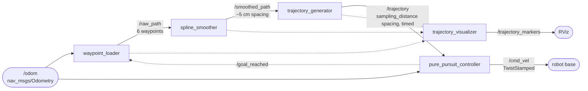
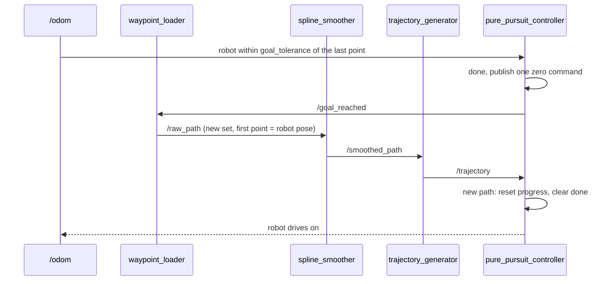
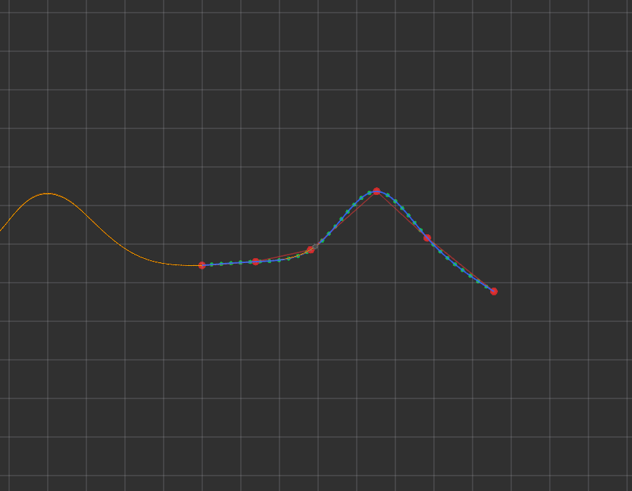

# Architecture

This page describes how the five nodes fit together, what each topic carries, and what happens when the robot reaches a goal.

## Overview



The maths sits in modules that don't import ROS (`path_math.py`, `pure_pursuit.py`). The node modules only convert messages, read parameters and call those functions, so all the behaviour can be unit tested without ROS.

| Module | Role |
|---|---|
| `path_math.py` | Waypoint generation, duplicate removal, spline smoothing, arc-length resampling, timing, headings, quaternion helpers |
| `pure_pursuit.py` | `PurePursuit`: progress tracking, lookahead search, steering law, slow-down, goal latch |
| `simulation.py` | Unicycle simulator and cross-track error, used by the tests and the figure script |
| `ros_utils.py` | `nav_msgs/Path` conversion, the latched QoS profile, the shared `main()` |

## Nodes

### waypoint_loader

- **Subscribes:** `/odom`, `/goal_reached`
- **Publishes:** `/raw_path`

It waits for the first odometry message, then publishes `num_waypoints` waypoints. The first waypoint is the robot's position. Each later one is 1–2 m further along the robot's heading, with a random sideways offset of up to ±2 m. When the controller announces on `/goal_reached` that the robot has arrived, a new set is made from the robot's current pose. Set `seed` to repeat the same sequence of paths.

### spline_smoother

- **Subscribes:** `/raw_path`
- **Publishes:** `/smoothed_path`

It removes consecutive duplicate waypoints, then fits a natural cubic spline through the rest, parameterised by arc length, and samples it about every `resolution` metres. Input with fewer than three distinct waypoints is logged and skipped.

### trajectory_generator

- **Subscribes:** `/smoothed_path`
- **Publishes:** `/trajectory`

It resamples the smoothed path at exact `sampling_distance` steps along its length and always keeps the final point. Each pose is stamped with its planned arrival time.

### pure_pursuit_controller

- **Subscribes:** `/trajectory`, `/odom`
- **Publishes:** `/cmd_vel`, `/goal_reached`

It runs at `control_frequency` (20 Hz) and works through these cases in order:

| Condition | Command |
|---|---|
| No trajectory or no odometry yet | nothing published |
| Odometry older than `odom_timeout`, or not finite (NaN, infinity) | one zero command, then a throttled warning |
| Within `goal_tolerance` of the last point | one zero command and one `/goal_reached` message; done until a new trajectory arrives |
| Lookahead point more than 90° off the heading | turn in place |
| Otherwise | pure pursuit, see [ALGORITHMS.md](ALGORITHMS.md#4-pure-pursuit) |

A trajectory identical to the current one is ignored, so progress along the path is kept. On Ctrl-C or SIGTERM the controller publishes a final zero command and waits up to 0.5 s for it to be delivered before it exits. A trajectory that arrives while the robot is already partway along it (for example after a controller restart) is picked up at the robot's nearest point, not at the start.

### trajectory_visualizer

- **Subscribes:** `/raw_path`, `/smoothed_path`, `/trajectory`
- **Publishes:** `/trajectory_markers`

It keeps one marker per namespace, always with id 0, so each update replaces the previous one in RViz and no stale markers are left behind:

| Namespace | Marker | Colour |
|---|---|---|
| `raw_waypoints` | sphere list, 0.2 m | red |
| `raw_path_line` | line strip | red, translucent |
| `smoothed_path` | line strip | blue |
| `trajectory_points` | sphere list, every 5th point | green |

## Message contracts

### Path topics

`/raw_path`, `/smoothed_path` and `/trajectory` are `nav_msgs/Path` messages published with this QoS:

```text
reliability: RELIABLE    durability: TRANSIENT_LOCAL    history: KEEP_LAST    depth: 1
```

Each path is published **once**, when it changes. Transient-local durability means a subscriber that starts later, such as RViz or a restarted controller, still receives the latest path. To see them from the command line, ask for the same durability:

```bash
ros2 topic echo /trajectory --qos-durability transient_local --qos-reliability reliable --once
```

A publisher that feeds one of these topics from outside, for example an external planner writing to `/raw_path` or `/trajectory`, must use the same durability. A volatile publisher (the default `create_publisher(Path, topic, 10)`) is QoS-incompatible with the transient-local subscribers here, and its messages are silently not delivered. Publish with `QoSProfile(depth=1, durability=DurabilityPolicy.TRANSIENT_LOCAL)`.

All three paths share these conventions:

- `header.frame_id` comes from the `frame_id` parameter (`odom` by default).
- `pose.position.z` is always 0.
- `pose.orientation` is the path heading at that point.

### Trajectory timing

On `/trajectory`, the `Path` header stamp is the time the trajectory was generated (t₀). Each pose's own `header.stamp` is t₀ + sᵢ / `velocity`, where sᵢ is the distance along the path to that pose. A consumer that needs time can read it from the per-pose stamps.

The pure-pursuit controller tracks the geometry only and does not use these times. It sets its own speed (see the slow-down in [ALGORITHMS.md](ALGORITHMS.md#slow-down-near-the-goal)).

### /cmd_vel

By default the controller publishes `geometry_msgs/TwistStamped` with `frame_id: base_link`, which TurtleBot3 on Jazzy expects. Launch with `stamped_cmd_vel:=false` for drivers that take plain `geometry_msgs/Twist`, such as `turtlebot3_fake_node`. Only `linear.x` and `angular.z` are set.

## Frames

Everything is expressed in one fixed frame, `odom` by default. The controller reads the robot pose straight from `/odom` and does not look up TF. If your robot's odometry is published in a different frame, set `frame_id` to match.

## Goal hand-over



The controller is the only node that decides when the goal is reached. It announces this once on `/goal_reached` (`std_msgs/Empty`, reliable, volatile), and the loader makes the next set in response. That way the two nodes can never disagree about the goal, whatever `goal_tolerance` is set to. The topic is volatile on purpose: an old announcement must not make a restarted loader skip a path. In the demo the new trajectory reaches the controller about 60 ms after the goal is announced. Because the new path starts at the robot, the robot carries straight on.



## Launch files

| File | Starts |
|---|---|
| `trajectory_nav.launch.py` | The five nodes, plus RViz with `rviz:=true`. Use it with any robot that publishes `/odom`. |
| `demo.launch.py` | `turtlebot3_fake_node` (burger), `robot_state_publisher`, the five nodes, and RViz. |

Arguments are listed in [PARAMETERS.md](PARAMETERS.md#launch-arguments).
