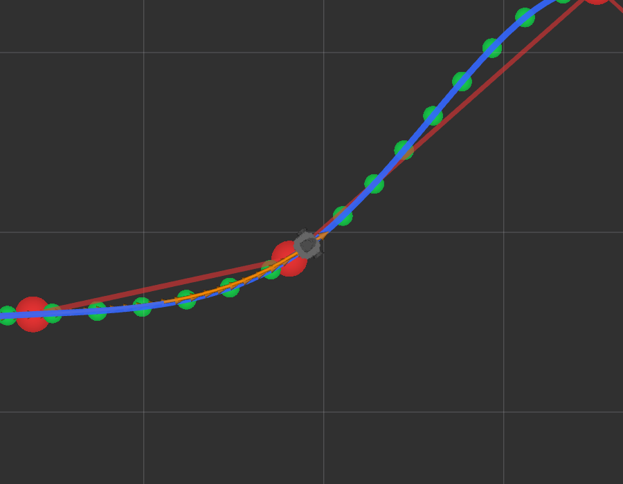

# Running with TurtleBot3

This package needs a robot that publishes `/odom` (`nav_msgs/Odometry`) and accepts velocity commands on `/cmd_vel`. TurtleBot3 does both, and it can run in three ways:

| Setup | Needs | `/cmd_vel` type | Sim time |
|---|---|---|---|
| Fake node (kinematic, no physics) | `turtlebot3_fake_node` | `Twist` | no |
| Gazebo Harmonic | `turtlebot3_gazebo` | `TwistStamped` | yes |
| Real robot | `turtlebot3_bringup` on the robot | `TwistStamped` | no |

Install the TurtleBot3 packages if you don't have them yet:

```bash
sudo apt install ros-jazzy-turtlebot3 ros-jazzy-turtlebot3-simulations
```

## 1. Fake node (the demo)

```bash
ros2 launch trajectory_nav demo.launch.py
```

This starts `turtlebot3_fake_node` (burger), `robot_state_publisher`, the five pipeline nodes and RViz. The fake node integrates the commanded velocities exactly, so it shows what the controller asks for, without physics. Add `rviz:=false` to run it headless.

The TurtleBot3 URDF uses xacro properties in its link names, so the demo runs it through `xacro` before handing it to `robot_state_publisher`. Loading the file as plain text gives frames called `${namespace}base_link`, and the robot model in RViz then shows an error.



## 2. Gazebo

Terminal 1, the simulator:

```bash
export TURTLEBOT3_MODEL=burger
ros2 launch turtlebot3_gazebo empty_world.launch.py
```

Terminal 2, the pipeline:

```bash
ros2 launch trajectory_nav trajectory_nav.launch.py use_sim_time:=true rviz:=true
```

Use `empty_world`. The random waypoints know nothing about obstacles, so in `turtlebot3_world` the robot will drive into the pillars. The default `stamped_cmd_vel:=true` matches the Jazzy Gazebo bridge, which converts `geometry_msgs/TwistStamped` on `/cmd_vel`.

This setup was checked on 2026-11-01 with the burger model: the robot reached consecutive goals 0.20 m from the end of each path.

**If the simulator hangs** with the spawner printing `Requesting list of world names` forever, Gazebo's network discovery is failing on your network interface. Pin it to loopback in both terminals:

```bash
export GZ_IP=127.0.0.1
```

## 3. Real robot

On the robot:

```bash
export TURTLEBOT3_MODEL=burger
ros2 launch turtlebot3_bringup robot.launch.py
```

On the robot or a PC on the same `ROS_DOMAIN_ID`:

```bash
ros2 launch trajectory_nav trajectory_nav.launch.py
```

Before letting it drive on its own:

- **Give it space.** Each set of waypoints reaches up to about 10 m ahead and ±2 m to the side, and nothing avoids obstacles. Lower `step_max` and `lateral_range` (and `num_waypoints`) for a small room. See [PARAMETERS.md](PARAMETERS.md).
- **Start slowly.** Use `velocity: 0.15` and a `lookahead_distance` of 0.5 m or more. Real latency and wheel slip make short lookaheads oscillate.
- **Know how to stop it.** Ctrl-C on the launch sends a final zero command. If odometry stops for more than `odom_timeout` (0.5 s), the controller stops the robot as well.

## Other robots

Any differential-drive base works if it:

1. publishes `nav_msgs/Odometry` on `/odom` (or you remap it), in the frame given by `frame_id`;
2. accepts `TwistStamped` on `/cmd_vel` (or use `stamped_cmd_vel:=false` for `Twist`).

To remap topics, add `remappings` to the nodes in your own launch file, for example `('/odom', '/my_robot/odom')`.

## Troubleshooting

| Symptom | Likely cause | Check |
|---|---|---|
| Robot doesn't move, no warnings | No `/odom`, so the loader is still waiting | `ros2 topic hz /odom` |
| Robot doesn't move, `/cmd_vel` is published | Wrong message type for the driver | `ros2 topic info /cmd_vel -v`: publisher and subscriber types must match; set `stamped_cmd_vel` |
| "Odometry is stale, stopping" | Odometry slower than 2 Hz, or the clocks disagree | `use_sim_time:=true` with Gazebo, `false` otherwise |
| No paths in RViz | RViz subscribing with volatile durability | The provided config uses transient local; if you add the display yourself, set *Durability Policy* to *Transient Local* |
| Robot model red in RViz | URDF not expanded with xacro, or no TF | Use `demo.launch.py`, or check `ros2 run tf2_ros tf2_echo odom base_footprint` |
